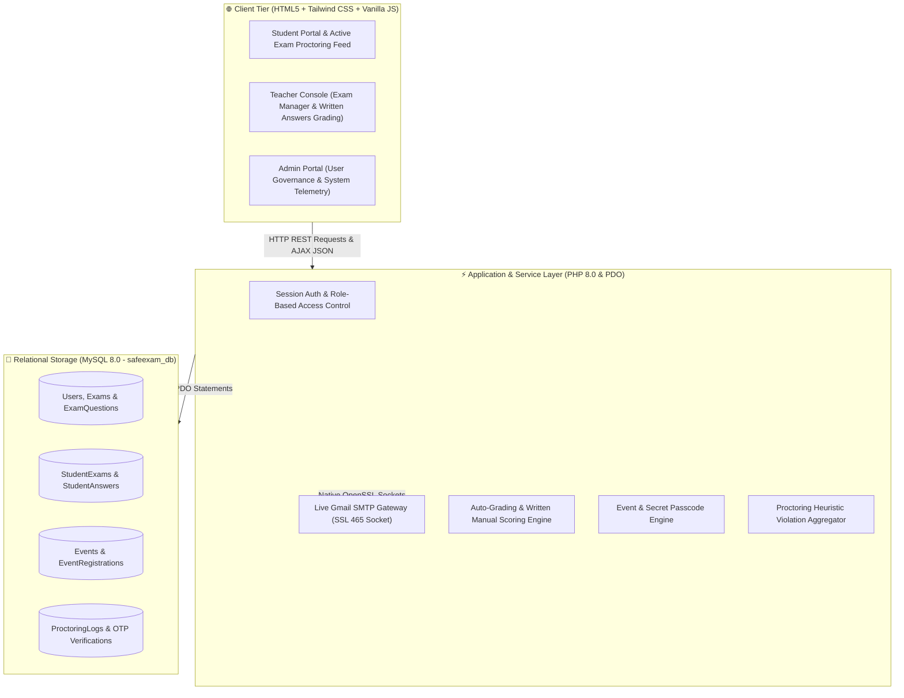

# 🛡️ SafeExam.Ai — Next-Gen AI-Powered Online Examination & Intelligent Proctoring System

[](https://www.php.net/)
[](https://www.mysql.com/)
[](https://www.apachefriends.org/)
[](https://tailwindcss.com/)
[](https://developer.mozilla.org/)
[](https://support.google.com/mail)

---

## 📌 Executive Summary

**SafeExam.Ai** is a full-featured, secure online examination and proctoring system engineered to uphold absolute academic integrity during remote and in-person assessments. Powered by a high-performance **PHP 8.0** backend, **MySQL** relational database, and responsive client-side UI, SafeExam.Ai delivers a unified educational assessment platform with zero external Node.js dependencies.

The platform provides dedicated, granularly controlled portals for **Students**, **Teachers**, and **System Administrators**, complete with automated & manual grading, instant color-coded answersheet reviews, event hackathons, and real-time live proctoring telemetry.

---

## 🏛️ System Architecture

SafeExam.Ai runs on a lightweight, modular PHP & MySQL architecture hosted seamlessly via Apache (XAMPP):



---

## 🔑 Key Features by Portal

### 1. 🎓 Student Portal (`/student/dashboard.php`)
- **Dashboard Home:** Welcome banner, real-time clock & live date indicator, KPI stat cards (Completed Exams, Registered Events, Average Score).
- **My Exams:** Search and filter exams, live status badges, attempt counter, and 3-attempt protected password modal.
- **Subject Insights:** Agent ELI diagnostic cards, strengths & attention areas, and interactive study goals checklist.
- **Events & Contests:** Dual-tab layout (All Events vs. Registered Events), one-click secret passcode copy, and direct **"Go for Exam"** launch.
- **My Results:** Complete transcripts table with GPA calculation and full-featured, color-coded answersheet review modal.
- **Student Profile:** Complete identity view with academic registration numbers and institutional affiliations.

### 2. 👨‍🏫 Teacher Console (`/teacher/dashboard.php`)
- **Exam Management:** Create exams with custom duration, passing percentage, instructions, and access passcodes.
- **Manual Live Toggle:** Control exam lifecycle with instant live toggle and result visibility switch.
- **Question Bank:** Add and manage MCQ questions (with 4 choices and explanations) and written descriptive questions.
- **Written Answer Grading:** Dedicated grading workflow with instant score recalculation, teacher feedback, and automatic publishing.
- **Event Manager:** Organize hackathons and competitions with dedicated secret codes and attendee roster tracking.
- **Live Proctoring Feed:** Auto-polling (every 5 seconds) feed monitoring active student violation logs, severity badges, and timestamps.

### 3. 🛡️ Admin Master Portal (`/admin/dashboard.php`)
- **Enterprise Governance:** Faculty approval/suspension toggles and comprehensive student directory.
- **Exams Oversight:** System-wide exam oversight with batch delete capabilities and active exam protection lock.
- **Proctoring Audit:** Centralized timeline of all system violations with student names, exam titles, and severity levels.
- **Events Governance:** Universal event management and participant oversight.
- **Admin Profile:** Master security credentials and institutional controls.

### 4. ✉️ Live Gmail SMTP OTP Authentication
- Native, zero-dependency SMTP client built directly on PHP OpenSSL stream sockets (`ssl://smtp.gmail.com:465`).
- **Registration Verification:** 2-step OTP email verification for all new Student and Teacher signups.
- **Forgot Password Recovery:** Secure 6-digit verification code sent directly to Gmail for password resets.

---

## 📂 Project Directory Structure

```plaintext
safeExam.Ai/
├── admin/
│   └── dashboard.php                   # System Administrator Console
├── api/
│   ├── complete_registration.php       # Verifies OTP and creates user
│   ├── get_answersheet.php             # Returns student submission details
│   ├── get_event_registrations.php     # Participant roster for events
│   ├── get_live_logs.php               # Real-time proctoring feed polling
│   ├── proctor_log.php                 # Logs violations during exam
│   ├── reset_password.php              # Verifies OTP and updates password
│   ├── save_answer.php                 # Autosaves answers during exam
│   ├── send_registration_otp.php      # Generates and emails registration OTP
│   ├── send_reset_otp.php             # Generates and emails reset OTP
│   └── submit_exam.php                 # Exam finalization and auto-grading
├── assets/
│   ├── css/
│   │   └── styles.css                  # Custom styling and animations
│   └── js/
│       └── main.js                     # Common client-side utilities
├── config/
│   ├── db.php                          # PDO MySQL connection
│   └── mail.php                        # Native Gmail SMTP socket transport
├── includes/
│   ├── auth_check.php                  # Role-based route guard
│   ├── footer.php                      # Reusable portal footer
│   └── header.php                      # Reusable portal header
├── student/
│   ├── dashboard.php                   # Complete 6-tab Student Portal
│   ├── exam.php                        # Active examination interface with AI monitoring
│   └── results.php                     # Examination results and transcripts
├── teacher/
│   ├── dashboard.php                   # Complete 6-tab Teacher Console
│   ├── events.php                      # Event & Contest manager
│   ├── grading.php                     # Written answer grading interface
│   ├── proctoring.php                  # Full-screen proctoring supervisor
│   └── questions.php                   # Question authoring and management
├── Agent-ELI/                          # Pre-trained ONNX/PyTorch AI weights
├── Diagram/                            # System architecture and workflow diagrams
├── database.sql                        # Complete MySQL schema and seed data
├── index.php                           # Application gateway and role router
├── login.php                           # Standalone authentication portal
├── logout.php                          # Session termination handler
├── register.php                        # 2-step OTP registration portal
├── .gitignore                          # Git tracking exclusions
└── README.md                           # Master documentation
```

---

## 🚀 Setup & Installation Guide

### Prerequisites
- **XAMPP** (with PHP 8.0+ and MySQL 8.0+)
- Active Internet connection (for Google CDN fonts, Tailwind CDN, and Gmail SMTP delivery)

### 1. Database Setup
1. Open **XAMPP Control Panel** and start **Apache** and **MySQL**.
2. Open **phpMyAdmin** (`http://localhost/phpmyadmin/`).
3. Create a new database named `safeexam_db` (or simply import the SQL file directly).
4. Import `database.sql` into MySQL.

### 2. Virtual Directory / Junction Setup
The application is accessed via `http://localhost/safeexam/`.

In Windows PowerShell (Run as Administrator or standard terminal), create a directory junction pointing from XAMPP `htdocs` to your project folder:
```powershell
cmd /c mklink /J "C:\Users\A\Desktop\Mehedi Desktop\Xmapp\htdocs\safeexam" "C:\Users\A\Desktop\Mehedi Desktop\Project\safeExam.Ai"
```

### 3. SMTP Mailer Configuration
The SMTP mailer configuration is located in `config/mail.php`. Pre-configured settings:
- **SMTP Host:** `ssl://smtp.gmail.com`
- **Port:** `465`
- **Sender Email:** `firegamingv8@gmail.com`
- **Sender Name:** `SafeExam.Ai Security`

### 4. Access the Application
Open your browser and navigate to:
```
http://localhost/safeexam/login.php
```

---

## 🔐 Default Demo Accounts

| Role | Email / Identifier | Password | Access Level |
| :--- | :--- | :--- | :--- |
| **System Administrator** | `mehedimridul1919@gmail.com` | `Admin@129221` | Full administrative oversight |
| **Teacher** | `teacher@safeexam.ai` | `teacher123` | Exam creation, grading & live supervision |
| **Student** | `232004048` or `student@safeexam.ai` | `student123` | Exam participation & results |

---

## 👨‍💻 Engineering & Capstone Credits

Developed as the Final Capstone Project for the Department of Computer Science & Engineering, **Primeasia University**:

- **Dr. MD Mehedi Hasan** — ID: `232004048`
- **MST Onamika Jannat Ara** — ID: `232005048`

---

## 📄 License
This project is proprietary and developed for academic and institutional evaluation. All rights reserved.
